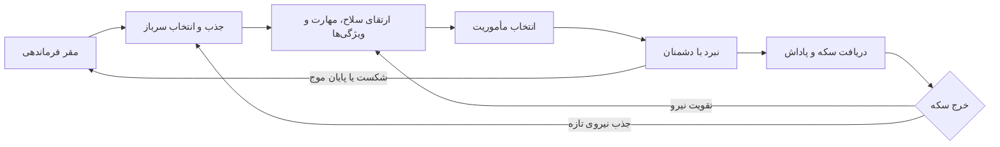

[[مقر]]
# سند طراحی بازی | مقر فرماندهی

> [!abstract] خلاصه
> یک بازی مدیریت نیرو و نبرد مرحله‌ای که بازیکن در نقش فرمانده، سرباز جذب می‌کند، آن‌ها را آموزش و تجهیز می‌کند و به میدان می‌فرستد. شکست دشمنان سکه می‌دهد؛ سکه‌ها برای تقویت سربازها و آماده‌شدن برای مأموریت‌های سخت‌تر مصرف می‌شوند.

## ۱. چشم‌انداز بازی

بازیکن از یک مقر کوچک شروع می‌کند و به‌تدریج نیرویی کارآمد می‌سازد. تجربه‌ی اصلی بازی بر سه حس تکیه دارد: **رشد قابل‌مشاهده‌ی سربازها، تصمیم‌گیری درباره‌ی خرج منابع، و هیجان پیروزی در برابر موج‌های دشمن**.

### نقش بازیکن

بازیکن فرمانده است؛ او ترکیب نیروها را انتخاب می‌کند، برای ارتقا اولویت می‌گذارد و زمان اعزام به نبرد را تعیین می‌کند. سربازها ابزارهای اصلی پیشرفت‌اند، اما موفقیت به انتخاب درست و آماده‌سازی آن‌ها بستگی دارد.

### هدف تجربه

- در چند دقیقه‌ی اول، بازیکن بتواند یک سرباز جذب کند و نخستین نبردش را شروع کند.
- پس از نبرد، پاداش به شکل روشن و رضایت‌بخش نمایش داده شود.
- هر خرج سکه، بهبود قابل‌فهمی در توان نیرو ایجاد کند.
- مأموریت‌های بعدی چالش بیشتری داشته باشند و ارتقا را معنادار کنند.

## ۲. چرخه‌ی اصلی بازی

**خلاصه‌ی یک دور بازی:** آماده‌سازی در مقر ← ورود به مأموریت ← مبارزه و شکست دشمنان ← دریافت پاداش ← بازگشت برای ارتقا و انتخاب مأموریت بعدی.

## ۳. مقر فرماندهی

مقر، مرکز تصمیم‌گیری و نقطه‌ی بازگشت بازیکن پس از هر مأموریت است. اطلاعات مهم باید در یک نگاه دیده شوند: تعداد سکه، وضعیت سربازها، ارتقاهای در دسترس و مأموریت پیشنهادی.

### امکانات مقر

- **اتاق نیروها:** مشاهده‌ی سربازها، سطح، سلامت، نقش و تجهیزات.
- **کارگاه اسلحه:** ارتقای سلاح و بررسی قدرت آسیب‌رسانی.
- **مرکز آموزش:** بهبود مهارت‌ها و ویژگی‌های پایه.
- **نقشه‌ی مأموریت‌ها:** انتخاب مرحله، نمایش نوع دشمن و سختی تقریبی.
- **نمایش منابع:** سکه‌ی فعلی و هزینه‌ی ارتقا یا جذب بعدی.

> [!tip] اصل رابط کاربری
> بازیکن باید همیشه بداند «الان چه کاری می‌توانم انجام دهم؟» و «هزینه و فایده‌ی آن چیست؟» دکمه‌ی اقدام اصلی هر صفحه واضح و در دسترس باشد.

## ۴. سربازها و جذب نیرو

بازیکن می‌تواند چند سرباز با نقش‌ها و سبک‌های متفاوت در اختیار داشته باشد. پیشنهاد اولیه برای نقش‌ها:

| نقش | کاربرد | نمونه‌ی ویژگی مميزة |
|---|---|---|
| مهاجم | واردکردن آسیب زیاد به هدف | قدرت حمله‌ی بالا |
| مدافع | جذب آسیب و محافظت از گروه | سلامت و زره‌ی بالا |
| پشتیبان | کمک به بقا یا توان رزمی گروه | درمان یا تقویت هم‌تیمی |

هر کارت سرباز بهتر است نام، تصویر یا آواتار، نقش، سطح، نوار سلامت، قدرت رزمی و دکمه‌ی جزئیات را نشان دهد. جذب سرباز جدید باید هزینه و نتیجه‌ی آن را پیش از تأیید روشن کند.

### ویژگی‌های پایه‌ی پیشنهادی

- **سلامت (HP):** میزان آسیبی که سرباز پیش از ازپاافتادن تحمل می‌کند.
- **قدرت حمله:** میزان آسیب پایه در هر حمله.
- **سرعت حمله:** تعداد یا بسامد حمله در بازه‌ی زمانی.
- **زره:** کاهش آسیب دریافتی.
- **دقت یا شانس بحرانی:** احتمال اثرگذاری حمله‌ی ویژه، در صورت نیاز به این عمق.

## ۵. ارتقا و پیشرفت

ارتقاها باید تفاوت ملموسی در عملکرد بسازند و مسیر خرج سکه برای بازیکن قابل‌فهم باشد.

### مسیرهای ارتقا

1. **ویژگی‌های سرباز:** افزایش سلامت، حمله یا زره.
2. **سلاح:** افزایش آسیب، سرعت شلیک یا بازکردن قابلیت سلاح.
3. **مهارت:** بهبود مهارت فعال یا غیرفعال و کاهش زمان بازیابی آن.
4. **سطح سرباز:** بازکردن ظرفیت رشد یا ارتقاهای جدید.

برای هر ارتقا نمایش دهید: مقدار فعلی، مقدار پس از ارتقا، هزینه‌ی سکه، و شرط لازم در صورت وجود. از نمایش عددی مبهم پرهیز کنید؛ مثلاً بنویسید «آسیب: ۱۲ ← ۱۵».

## ۶. مأموریت و مبارزه

در میدان نبرد، سربازها با موج‌های دشمن روبه‌رو می‌شوند. در نسخه‌ی اولیه، مبارزه می‌تواند خودکار باشد تا تمرکز بازیکن بر انتخاب ترکیب و آماده‌سازی بماند. بعداً می‌توان فرمان‌های تاکتیکی یا فعال‌سازی دستی مهارت‌ها را اضافه کرد.

### جریان نبرد

- پیش از شروع، بازیکن ترکیب نیرو و مأموریت را بررسی می‌کند.
- دشمنان در موج‌ها وارد می‌شوند و سربازها طبق نقش و اولویت هدف حمله می‌کنند.
- سلامت نیرو، موج جاری، دشمنان باقی‌مانده و پیشرفت مأموریت نمایش داده می‌شوند.
- هر دشمن شکست‌خورده سکه می‌دهد؛ پایان موج یا مأموریت می‌تواند پاداش اضافه داشته باشد.
- پس از پایان، خلاصه‌ی نتیجه و گزینه‌ی بازگشت به مقر یا ادامه نشان داده می‌شود.

### پاداش پیشنهادی

| رویداد | پاداش نمونه |
|---|---|
| شکست هر دشمن | چند سکه بر اساس نوع دشمن |
| پاک‌سازی موج | پاداش تکمیلی |
| پایان مأموریت | سکه و احتمالاً آیتم یا امتیاز پیشرفت |
| مأموریت ویژه | پاداش خاص و یک‌باره |

> [!note] تعادل اقتصادی
> مقدار پاداش و هزینه‌ی ارتقا باید طوری تنظیم شوند که بازیکن مرتب پیشرفت کند، اما برای انتخاب اینکه کدام نیرو را زودتر تقویت کند فرصت تصمیم‌گیری داشته باشد. اعداد نهایی پس از نمونه‌سازی و سنجش بازی تعیین شوند.

## ۷. دشمنان و افزایش سختی

برای تنوع، دشمن‌ها می‌توانند در سلامت، آسیب، سرعت و رفتار متفاوت باشند. نمونه‌های اولیه: دشمن عادی برای یادگیری نبرد، دشمن سریع برای فشار به نیروهای پشتیبان، دشمن زره‌دار برای آزمودن قدرت حمله، و دشمن سنگین یا باس به‌عنوان پایان موج ویژه.

سختی مأموریت‌ها به‌تدریج بالا می‌رود: سلامت و قدرت دشمن، ترکیب موج‌ها و تعداد دشمنان افزایش می‌یابد. پیش از ورود، سطح تهدید و پاداش احتمالی نشان داده شود.

## ۸. صفحات و منوهای پیشنهادی

1. **صفحه‌ی اصلی مقر:** وضعیت نیرو، سکه، اعلان ارتقا و دکمه‌ی شروع مأموریت.
2. **فهرست سربازها:** کارت نیروها، فیلتر نقش و دسترسی به جزئیات.
3. **جزئیات سرباز:** ویژگی‌ها، سلاح، مهارت‌ها و عملیات ارتقا.
4. **انتخاب مأموریت:** نقشه، درجه‌ی سختی، نوع دشمن و پاداش.
5. **صفحه‌ی نبرد:** میدان، سلامت سربازها، موج و پاداش لحظه‌ای.
6. **نتیجه‌ی مأموریت:** نتیجه، دشمنان شکست‌خورده، سکه‌ی کسب‌شده و ادامه.

## ۹. نسخه‌ی اولیه‌ی قابل‌بازی (MVP)

برای نمونه‌ی اولیه، این قابلیت‌ها کافی‌اند:

- مقر با شمارنده‌ی سکه و دسترسی به نیروها و مأموریت.
- حداقل سه سرباز یا سه نقش قابل‌تشخیص.
- ارتقای یک ویژگی و یک سلاح با سکه.
- یک میدان نبرد، چند نوع دشمن و چند موج.
- پاداش سکه برای شکست دشمن و صفحه‌ی نتیجه.
- ذخیره‌ی پیشرفت بازیکن میان اجراها.

قابلیت‌هایی مثل چندین مقر، داستان شاخه‌ای، تجهیزات کمیاب، نبرد آنلاین و درخت مهارت بزرگ می‌توانند به مراحل بعد موکول شوند.

## ۱۰. معیارهای موفقیت و پرسش‌های طراحی

### معیارهای قابل‌اندازه‌گیری

- آیا بازیکن بدون راهنمایی متوجه جذب، ارتقا و شروع مبارزه می‌شود؟
- آیا پاداش پس از شکست دشمن قابل‌مشاهده و قابل‌درک است؟
- آیا بازیکن می‌تواند توضیح دهد ارتقای انتخاب‌شده چه تغییری ایجاد کرد؟
- آیا بازیکن پس از یک مأموریت انگیزه دارد دوباره به مقر برگردد؟

### تصمیم‌هایی که باید نهایی شوند

- مبارزه کاملاً خودکار است یا بازیکن فرمان مستقیم هم می‌دهد؟
- سربازها در صورت شکست حذف می‌شوند، موقتاً از دسترس خارج می‌شوند یا پس از مأموریت بازیابی می‌شوند؟
- جذب نیرو تصادفی است یا بازیکن سرباز مشخصی انتخاب می‌کند؟
- سکه تنها منبع ارتقاست یا منابع دیگری هم وجود دارد؟
- بازی مرحله‌ای است یا مأموریت‌ها بی‌پایان/موجی ادامه دارند؟

---

## راهنمای استفاده از تصاویر

تصویرها در پوشه‌ی `images` کنار همین یادداشت هستند و با پیوندهای Markdown درج شده‌اند. در صورت جابه‌جایی یادداشت، پوشه‌ی تصاویر را هم همراه آن جابه‌جا کنید.
